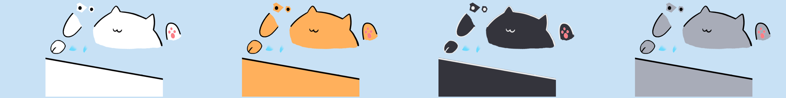

# BongoCat 毛色模型合集

基于 [ayangweb/BongoCat](https://github.com/ayangweb/BongoCat) 自带的 standard 模型换了主贴图，动作、表情和键盘交互与原版一致。

## 预览

三花猫（左原版，右三花）：

四个版本（从左到右：原版、橘猫、黑猫、灰猫）：

## 模型列表

| 文件夹 | 毛色 |
|---|---|
| bongo-calico | 三花猫 |
| bongo-orange | 橘猫 |
| bongo-black | 黑猫 |
| bongo-gray | 灰猫 |

## 导入方法

1. 下载或克隆本仓库。
2. 打开 BongoCat 设置，进入模型库，点击导入模型。
3. 选择想要的模型文件夹（例如 bongo-calico），导入后点击使用。

## 许可证与来源

这些模型沿用原项目 standard 模型的骨架（.moc3）、动作、表情和音频文件，只修改了主贴图 `demomodel.1024/texture_00.png`。

原项目采用 Apache License 2.0，本仓库同样以 Apache License 2.0 发布，完整条款见 [LICENSE](LICENSE)。
